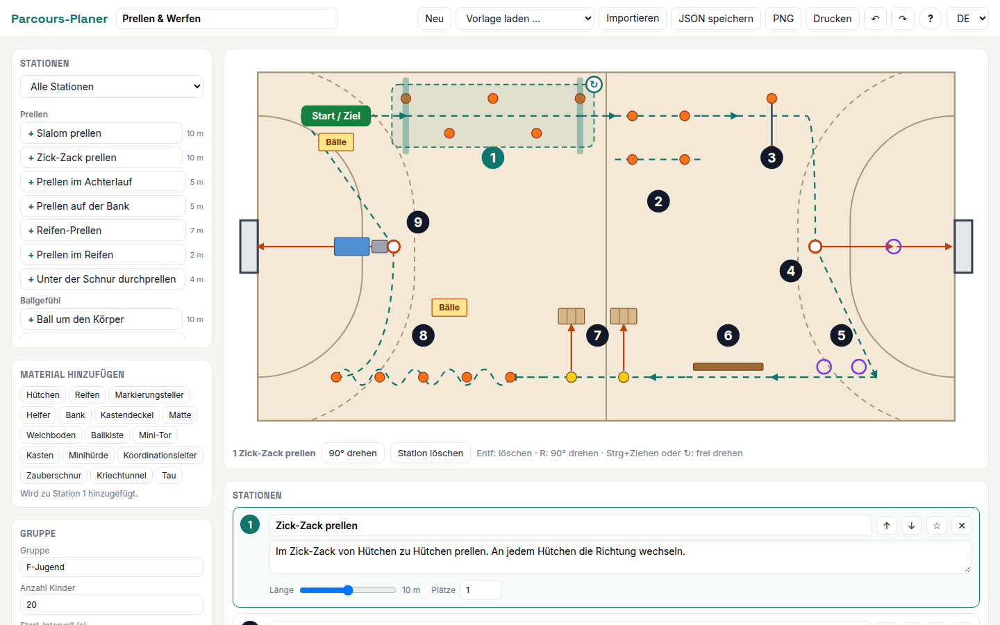
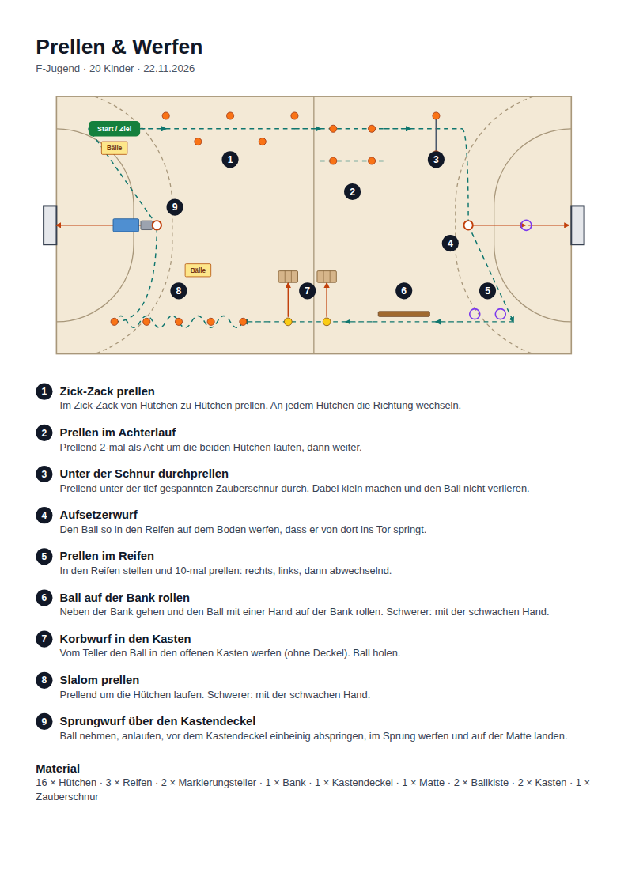

# Parcours-Planer

A web app for handball coaches to plan a gym parcours (obstacle course) for young children, made for the F-Jugend (under 9). You build the parcours step by step: each station is placed clockwise around the hall. You can then print it on A4 or share it as an image.

The interface is in German and English.

**Online:** https://seeb83ai.github.io/parcours_planner/



<p align="center">
  
  <br><em>The printed page (A4 portrait). The PNG export has the same layout.</em>
</p>

## Features

- **Step-by-step building:** pick a station from the catalog. It goes on a lane 2.5 m inside the walls, after the selected station.
- **Goal stations:** at most one in front of each goal. They have a throw spot and a run path that you can bend.
- **Catalog with 52 stations:** dribbling, ball feeling, passing, throwing, defence and movement. The stations follow common F-Jugend exercises, for example from the BWHV/HVW Kinderhandball catalog.
- **Filter:** narrow the catalog with a dropdown:
  - by ball: with ball, without ball
  - by activity: dribbling, passing, throwing, ball feeling, defence, jumping, crawling and rolling, goal stations
  - by equipment: cones, hoops, bench, mat, box, helper needed, little equipment
- **Places (Plätze):** more places repeat a station's set-up side by side or one after another. The equipment list counts every place.
- **Length:** drag the bar at the start or end of a selected station, or use the slider. Rows of cones, hoops, hurdles, mats or cone gates keep at least their spacing: an item is added as soon as it fits and removed when it no longer does.
- **Free editing:** drag stations, equipment and number badges. Rotate with Ctrl+drag or the ↻ handle, or by 90° with the R key. Delete with Del. You can also add extra equipment.
- **Checks:** the app shows the time until the last child starts, stations with queue risk, and stations that no longer fit.
- **Output:**
  - Print on A4 portrait: the court, one description per station, and the equipment list.
  - The same page as a PNG.
  - Save and load the parcours as a JSON file.
- **7 ready-made parcours** ("Vorlage laden"):
  - Bewegungs-Parcours
  - Ball-Parcours
  - Koordinations-Parcours
  - Prellen & Werfen
  - Turnhallen-Abenteuer
  - Mit wenig Material (only cones, hoops and discs)
  - Pass- und Wurf-Zirkel
- **Your own stations:** save a changed station as your own (☆). The browser keeps your stations and the current draft.

## Use it

The app is static: HTML, CSS and JavaScript modules, with no build step and no server code. The browser blocks JavaScript modules from `file://`, so serve the folder over HTTP:

```sh
python3 -m http.server 8000
# open http://localhost:8000
```

Quick start:
1. Pick a station in the list on the left. It goes onto the lane.
2. Click a station on the court or in the list to select it. Drag to move it, drag the bar at its start or end to change its length, and use the ↻ handle to rotate it.
3. Change the name, task text, length and places below the court.
4. Use **PNG** or **Drucken** (print) to share the plan. **JSON speichern** saves it as a file, and **Importieren** loads one.

### Keyboard

| Key | Action |
|-----|--------|
| Del / Backspace | Delete the selected equipment or station |
| R | Rotate the selection by 90° |
| Ctrl + drag (Cmd on a Mac) | Rotate freely in 15° steps |
| Ctrl+Z / Ctrl+Y | Undo / redo |
| Esc | Clear the selection |
| ? | Open the help (also the **?** button at the top) |

## Deploy

All paths are relative, so you can serve the folder from any web server:

- **GitHub Pages:** the workflow `.github/workflows/ci.yml` runs the tests on every push and pull request. It deploys `main` to Pages only when the tests pass. In Settings → Pages, set the source to **GitHub Actions**.
- **nginx (for example on a Raspberry Pi):** copy the files into the web root, or point a `location` at the folder. No other set-up is necessary.

## Development

| File | Content |
|------|---------|
| `index.html`, `style.css`, `app.js` | Editor UI, events, undo, storage, export |
| `model.js` | Lane layout, coordinates, places, rotation, material count, import validation. It does not use the DOM. |
| `court.js` | SVG drawing of the court and the A4 print page |
| `stations.js` | Station catalog |
| `i18n.js` | German and English UI texts |
| `presets.js` | Ready-made parcours, built from the catalog when loaded |
| `test.js`, `test.html` | Logic checks |
| `PLAN.md` | Design decisions and the data format (schemaVersion 2) |
| `drafts/` | Original research, scripts and design drafts |

To run the tests:

```sh
node test.js        # or open test.html in the browser
```

### Add a preset

Add an entry to `PRESETS` in `presets.js`. It lists catalog stations in clockwise order, with an optional `length` and `capacity` for each station. The app builds the preset from the current catalog, in the chosen language. `node test.js` checks that every station of every preset fits on the lane.

### Add a station

Add an entry to `CATALOG` in `stations.js`. The comment at the top of the file explains the coordinates:

- `u` is the distance along the running direction.
- `v` is the distance across, towards the centre of the court.
- `f` is a fraction of the station length: an item with `f` moves when the length changes.

Other fields:

| Field | Meaning |
|-------|---------|
| `spots` | `'across'` (default): extra places go side by side. `'along'`: extra places go one after another. |
| `spotStep` | Distance between places side by side, in metres (default 2) |
| `flow: true` | Children follow each other without waiting, so the app shows no queue warning |
| `TAGS` | List at the end of `stations.js`. Add the station there if it belongs to `springen`, `kriechen` or another filter that the app cannot derive from the skill or the equipment. |

Write the texts as `{ de, en }`.

To add an equipment type:
1. Add its size to `ITEM_TYPES` in `model.js`.
2. Add its colour to `COL` in `court.js`.
3. Add its names to `i18n.js`.

## License

© 2026 Sebastian Detert. Licensed under [CC BY-NC-SA 4.0](https://creativecommons.org/licenses/by-nc-sa/4.0/). The full text is in [`LICENSE`](LICENSE).

- **You may** use, copy, change and share this project for free, for any **non-commercial** purpose. Clubs, coaches, schools and private use are all fine.
- **You must** credit the author and link to the license.
- **Derivatives must stay open:** if you share a changed version, you must publish it under the same license.
- **Not allowed:** use in or as a commercial product or service.

This licence is not an "open source" licence as the OSI defines it, because it does not allow commercial use.
